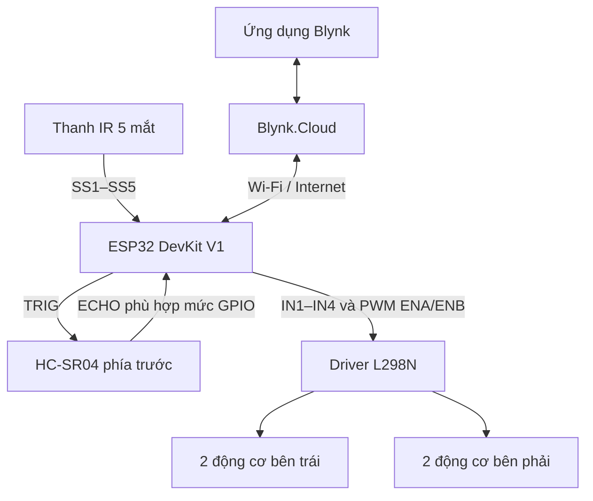

# Xe dò line kết hợp tránh vật cản và điều khiển từ xa qua Blynk

### Lộ trình thiết kế, chế tạo và phát triển trong 3 tuần

Thiết kế và chế tạo xe bốn bánh sử dụng ESP32 DevKit V1, cảm biến dò line năm mắt, HC-SR04 và driver L298N. Hai chế độ **Auto–Manual** được lựa chọn qua ứng dụng Blynk trên điện thoại.

**Thời gian triển khai:** 3 tuần, từ lắp ráp và thử động cơ đến dò line, tránh vật cản và điều khiển qua Blynk.

README trình bày công việc theo từng tuần, các bước nâng cấp, đầu ra cần đạt và cách kiểm tra. Ngày được tính từ lúc bắt đầu dự án, kết quả thực tế được ghi sau khi thử xe.

**Phần cứng:** ESP32 · L298N · 4 động cơ DC · IR 5 mắt · HC-SR04 · 2 cell pin Li-ion 18650 mắc nối tiếp — bộ pin 2S.

**Giao diện:** Blynk qua Wi-Fi/Internet.

## 1. Mục tiêu và hai chế độ vận hành

| Chế độ | Chức năng | Xử lý vật cản phía trước |
|---|---|---|
| **Auto — chế độ 1** | Bám vạch đen trên nền sáng, xử lý giao lộ và tìm lại line | Tạm dừng dò line, thực hiện chuỗi tránh đã lập trình, tìm lại vạch để tiếp tục |
| **Manual — chế độ 2** | Nhận lệnh Tiến, Lùi, Trái, Phải và mức PWM từ Blynk | Ưu tiên dừng, chặn tiến khi khoảng cách không bảo đảm điều kiện chạy |

Các mục tiêu kỹ thuật:

- Điều khiển độc lập **hai nhóm động cơ trái/phải**, mỗi nhóm hai động cơ cùng phía.
- Đọc năm mắt IR, tính sai lệch vị trí vạch và hiệu chỉnh bằng bộ điều khiển PID.
- Đo khoảng cách phía trước bằng HC-SR04 để phục vụ tránh vật cản và chặn tiến.
- Giám sát trạng thái, khoảng cách và điều khiển hai chế độ qua Blynk.
- Đánh giá chức năng bằng phép thử có điều kiện, thông số và kết quả ghi nhận rõ ràng.

Một HC-SR04 cố định chỉ quan sát vùng phía trước, chưa giám sát phía sau và hai bên.

## 2. Lộ trình thực hiện và phát triển trong 3 tuần

| Giai đoạn | Trọng tâm | Đầu ra cần đạt |
|---|---|---|
| **Tuần 1 · Ngày 1–7** | Lắp ráp cơ khí, đấu nối nguồn và điều khiển động cơ | Xe chạy đúng các lệnh tiến, lùi, trái, phải, dừng và thay đổi được mức PWM |
| **Tuần 2 · Ngày 8–14** | Đọc IR, dò line cơ bản, nâng cấp PID và xử lý tình huống | Có phiên bản dò line để thử đường thẳng, cua, giao lộ và mất line |
| **Tuần 3 · Ngày 15–21** | Bổ sung HC-SR04, Blynk, hai chế độ và kiểm thử tổng thể | Hoàn thiện chương trình và chạy  xe ở hai chế độ: tự động và điều khiển từ xa.  |

### 2.1. Tuần 1 — Lắp ráp và làm chủ chuyển động

**Mục tiêu:** Xây dựng nền tảng cơ khí, nguồn cấp và các lệnh chuyển động trước khi cho xe tự dò line.

| Thời gian | Công việc thực hiện | Cách kiểm tra |
|---|---|---|
| Ngày 1 | Xác định chức năng hai chế độ ,thống kê linh kiện, sơ đồ khối và bảng chân | Mỗi khối có chức năng, nguồn cấp và đường tín hiệu rõ ràng |
| Ngày 2–3 | Lắp khung, bốn động cơ, bánh xe, pin, ESP32 và L298N; đi dây nguồn | Khung chắc, bánh không cạ, dây không vướng bánh; kiểm tra cực tính và điện áp |
| Ngày 4–5 | Viết và thử riêng các lệnh tiến, lùi, trái, phải, dừng | Hai bánh cùng phía quay phối hợp đúng, gọi từng lệnh cho kết quả đúng hướng |
| Ngày 6 | Thêm PWM và thử nhiều mức điều khiển khi đặt xe xuống nền | Ghi mức PWM xe bắt đầu chuyển động, mức phù hợp để thử chậm và độ lệch hai bên |
| Ngày 7 | Kiểm tra lại chuyển động, nguồn và mối nối, lưu phiên bản điều khiển cơ bản | Xe thực hiện đủ các lệnh, dừng được và không khởi động lại trong điều kiện đã thử |

**Cách phát triển:** Thử một nhóm động cơ, sau đó thử cả hai nhóm; xác nhận chiều quay rồi mới thêm thay đổi PWM. Khi xe lệch hướng, kiểm tra cực tính, ma sát bánh và mức điều khiển hai bên trước khi chuyển sang thuật toán dò line.

**Đầu ra cuối tuần:**

- Khung xe và đường nguồn đã kiểm tra.
- Bảng chân ESP32–L298N và chương trình thử chuyển động.
- Ghi chép chiều quay, mức PWM đã thử và vấn đề cơ khí/nguồn còn tồn tại.

**Tiêu chí chuyển sang tuần 2:** Xe đáp ứng đúng từng lệnh chuyển động, có thể điều chỉnh PWM và dừng theo yêu cầu trong điều kiện thử nghiệm.

### 2.2. Tuần 2 — Từ dò line cơ bản đến PID

**Mục tiêu:** Đọc đúng năm mắt IR, cho xe bám vạch, sau đó cải thiện phản ứng ở cua, giao lộ và khi mất line.

| Thời gian | Công việc thực hiện | Cách kiểm tra |
|---|---|---|
| Ngày 8 | Gá thanh IR phía trước gầm, chỉnh độ cao/độ nhạy và in dữ liệu từng mắt | Đưa từng mắt lên nền trắng và vạch đen, xác nhận thứ tự trái qua phải và quy ước tín hiệu |
| Ngày 9 | Viết dò line theo điều kiện: vạch ở giữa, lệch trái, lệch phải và không thấy vạch | Xe hiệu chỉnh đúng hướng ở mức PWM thấp |
| Ngày 10–11 | Tính sai lệch từ năm mắt, thêm PID và hiệu chỉnh từng tham số | Thử cùng sa hình, ghi dao động, khả năng bắt cua và số lần mất line |
| Ngày 12 | Xác nhận giao lộ, chọn thứ tự ưu tiên rẽ và thử từng nhánh | Kiểm tra ngã ba/ngã rẽ: quan sát trường hợp nhận nhầm giao lộ |
| Ngày 13 | Bổ sung tìm lại line và thử quay đầu khi cần | Chủ động đặt xe lệch khỏi vạch: kiểm tra cả tìm thấy và tìm thất bại |
| Ngày 14 | Chạy lại các tình huống, ghi cấu hình và lưu bản dò line nền tảng | Mã nguồn, thông số và minh chứng thuộc cùng một phiên bản |

**Trình tự nâng cấp thuật toán:**

1. Đọc cảm biến và in dữ liệu để xác nhận từng mắt hoạt động đúng.
2. Điều khiển theo điều kiện: thấy vạch ở giữa thì tiến, vạch lệch bên nào thì hiệu chỉnh về bên đó.
3. Gán trọng số cho năm mắt, tính sai lệch và thêm PID để điều chỉnh hai nhóm động cơ.
4. Bổ sung xác nhận giao lộ và quy tắc chọn nhánh.
5. Bổ sung khôi phục line, quay đầu và xử lý khi tìm kiếm thất bại theo phiên bản chương trình.

Khi xe lao ra ngoài ở cua, dao động hoặc phản ứng chậm, kiểm tra theo thứ tự **vị trí cảm biến → logic đọc → chu kỳ xử lý → mức PWM → tham số PID**. Mỗi lần chỉ đổi một yếu tố và thử lại cùng điều kiện để xác định ảnh hưởng.

**Đầu ra cuối tuần:**

- Chương trình đọc IR, dò line theo điều kiện và dò line PID.
- Bảng thông số đã thử, kèm mức PWM và điều kiện sa hình.
- Minh chứng đường thẳng, cua, giao lộ và mất line.
- Danh sách vấn đề cần xử lý khi ghép HC-SR04/Blynk trong tuần 3.

**Tiêu chí chuyển sang tuần 3:** Đã kiểm tra phản ứng trên các tình huống cơ bản, lưu được phiên bản dò line để đối chiếu trước và sau tích hợp.

### 2.3. Tuần 3 — Tích hợp HC-SR04, Blynk và hai chế độ

**Mục tiêu:** Mở rộng xe dò line thành xe hai chế độ, xử lý vật cản tại ESP32 và kiểm thử toàn hệ thống.

| Thời gian | Công việc thực hiện | Cách kiểm tra |
|---|---|---|
| Ngày 15 | lắp HC-SR04 và thử đọc khoảng cách riêng | So sánh với thước tại nhiều vị trí sau đó ghi đơn vị, sai số và lần đo lỗi |
| Ngày 16 | Ghép đo khoảng cách với dò line: xây dựng chuỗi tránh và tìm lại vạch | Thử vật cản trên sa hình ở mức PWM thấp: kiểm tra từng bước của chuỗi tránh |
| Ngày 17 | Thiết lập thiết bị, datastream và giao diện Blynk, thử nhận/gửi dữ liệu | Khoảng cách, trạng thái và lệnh nhận tại ESP32 khớp giao diện |
| Ngày 18 | Thêm Manual, bốn nút hướng, chỉnh PWM và tự dừng trước vật cản | Kiểm tra nhấn/thả, giữ nút Tiến khi có vật cản vẫn phải dừng |
| Ngày 19 | Ghép chọn Auto–Manual, ưu tiên dừng và xử lý mất kết nối | Chỉ một chế độ điều khiển, đổi chế độ không phát lại lệnh hướng cũ |
| Ngày 20 | Chạy kiểm thử tổng thể, hiệu chỉnh và ghi kết quả | Thực hiện bảng kiểm ở mục 10, lưu điều kiện và minh chứng cho từng phép thử |
| Ngày 21 | Hoàn thiện báo cáo, hướng dẫn vận hành và đồng bộ kho mã nguồn | Tài liệu, chương trình nạp trên xe và minh chứng cùng phiên bản, ghi rõ nội dung chưa đạt |

**Các bước tích hợp chính:**

1. **Đo khoảng cách độc lập:** Kiểm tra HC-SR04 trước khi đưa kết quả đo vào điều khiển chuyển động.
2. **Auto:** Kết hợp dò line với phát hiện vật cản, dừng, thực hiện chuỗi tránh và tìm lại vạch.
3. **Manual:** Nhận lệnh Blynk; khi vật cản phía trước nằm trong khoảng cách dừng đã cài đặt, dừng và chặn tiến kể cả khi vẫn giữ nút Tiến.
4. **Điều phối:** Dừng trước khi đổi chế độ, xóa lệnh cũ và ưu tiên yêu cầu dừng.
5. **Kiểm chứng:** Thử mất kết nối, dữ liệu khoảng cách lỗi và tình huống không tìm lại được line, điều chỉnh chương trình theo kết quả.

**Đầu ra cuối tuần:**

- Chương trình tích hợp đúng phiên bản và bảng cấu hình Blynk.
- Kết quả thử Auto–Manual, kèm thông số, ảnh/video và các vấn đề chưa xử lý.

**Tiêu chí hoàn thành:** Các chức năng được kiểm chứng bằng phép thử có kết quả ghi nhận.hững mục chưa đạt tiếp tục nằm trong danh sách hoàn thiện. Chưa dùng việc có giao diện hoặc đã đấu nối cảm biến làm bằng chứng chức năng tích hợp hoạt động ổn định.

Công cụ sử dụng trong quá trình phát triển gồm MicroPython/Thonny, Arduino IDE cho các bản C/C++, Serial Monitor và GitHub. Các phiên bản chạy được cần được lưu trước mỗi lần nâng cấp để có thể đối chiếu hoặc khôi phục.

## 3. Kiến trúc hệ thống

ESP32 đọc cảm biến và tiếp nhận dữ liệu Blynk vào các biến lệnh. Khối điều phối xét chế độ và điều kiện bảo vệ trước khi xuất lệnh cuối cùng cho L298N. Khoảng cách và trạng thái xử lý được gửi về ứng dụng để giám sát.

Các nút Blynk là thành phần phần mềm trao đổi qua datastream; chúng không sử dụng thêm GPIO như nút nhấn vật lý. Xử lý dừng do vật cản nằm tại ESP32, còn lệnh dừng qua Blynk phụ thuộc kết nối mạng.

## 4. Phần cứng và nguồn cấp

### 4.1. Linh kiện của mô hình hiện tại

| Thành phần | Số lượng | Vai trò |
|---|---|---|
| ESP32 DevKit V1 | 1 | Đọc cảm biến, điều phối hai chế độ, tạo PWM và kết nối Wi-Fi |
| Module L298N cầu H đôi | 1 | Điều khiển chiều quay và PWM hai nhóm động cơ |
| Động cơ DC giảm tốc và bánh xe | 4 bộ | Tạo chuyển động cho bốn bánh chủ động |
| Thanh IR năm mắt | 1 | Xác định vị trí vạch đen trên nền sáng |
| HC-SR04 | 1 | Đo khoảng cách vật cản phía trước |
| Khung xe mica | 1 bộ | Mang động cơ, cảm biến, pin và mạch điều khiển |
| Cell Li-ion 18650 mắc nối tiếp 2S | 2 | Nguồn danh định 7,4 V; 8,4 V khi sạc đầy |
| Công tắc và dây dẫn | Theo lắp ráp | Đóng/ngắt nguồn và kết nối các khối |

Hai động cơ cùng phía mắc song song trên một cầu H. Dòng qua mỗi cầu bằng tổng dòng hai động cơ, cần xét cả lúc khởi động/kẹt trục và khả năng tản nhiệt của driver. Arduino Uno thuộc các phiên bản thử nghiệm trước đây, không nằm trong cấu hình xe ESP32 hai chế độ hiện tại.

### 4.2. Phân phối nguồn theo cấu hình báo cáo

| Nhánh nguồn | Kết nối và điều kiện |
|---|---|
| Pin 2S → L298N | Cấp nguồn động lực vào VS của driver |
| Nhánh ổn áp 5 V trên module L298N → ESP32 | Cấp vào chân 5V/VIN theo đúng ký hiệu bo |
| 3V3 ESP32 → thanh IR | Áp dụng với module hỗ trợ nguồn 3,3 V |
| Nguồn HC-SR04 | Báo cáo mô tả lấy từ 3V3; chỉ áp dụng với phiên bản được công bố hỗ trợ 3,3 V |
| GND | Nối chung mass của pin, ESP32, L298N và cảm biến |

Module L298N phổ biến có ổn áp tuyến tính 5 V, thường dùng 78M05 hoặc tương đương. Cấu hình hiện tại lấy nhánh 5 V từ module này; **không liệt kê LM2596 rời là linh kiện đã lắp**. Đối chiếu đúng bo và jumper **5V-EN**, kiểm tra đường 5 V khi động cơ/Wi-Fi hoạt động. Khi cấp 5 V ngoài cho phần logic driver, cấu hình jumper theo tài liệu bo để tránh đấu chồng nguồn.

**VCC của HC-SR04 và mức ECHO cần được xác nhận riêng.** Có bản HC-SR04 yêu cầu 5 V và có biến thể hỗ trợ 3,3–5 V. Với bản yêu cầu 5 V, cấp VCC theo tài liệu cảm biến và hạ mức ECHO trước GPIO ESP32. Bộ chia áp/chuyển mức ECHO nằm trên đường tín hiệu; ổn áp của L298N không thực hiện chức năng này. Kiểm tra phiên bản cảm biến thực tế trước khi đấu nối.

### 4.3. Bố trí cơ khí

- Thanh IR đặt phía trước gầm xe, hướng xuống mặt đường; cân chỉnh độ cao/độ nhạy theo sa hình.
- HC-SR04 hướng về trước, không bị khung hoặc dây dẫn che hai đầu dò.
- Cố định pin, dây động lực và các mối nối để hạn chế rung, va quệt và đứt dây.

## 5. Cấu hình chân ESP32

### 5.1. Driver L298N

| ESP32 | L298N | Chức năng |
|---|---|---|
| GPIO27 | IN1 | Chiều quay nhóm trái |
| GPIO26 | IN2 | Chiều quay nhóm trái |
| GPIO14 | ENA | PWM nhóm trái |
| GPIO25 | IN3 | Chiều quay nhóm phải |
| GPIO33 | IN4 | Chiều quay nhóm phải |
| GPIO32 | ENB | PWM nhóm phải |
| GND | GND | Mass chung |

OUT1/OUT2 nối nhóm trái, OUT3/OUT4 nối nhóm phải; kiểm tra cực tính để hai bánh cùng phía cùng đẩy xe theo hướng yêu cầu. Tháo jumper ENA/ENB khi dùng PWM từ ESP32. Hai jumper này khác jumper nguồn 5V-EN.

### 5.2. Thanh IR năm mắt

Thứ tự từ trái sang phải khi nhìn theo hướng xe tiến:

| Mắt cảm biến | ESP32 GPIO | Trọng số |
|---|---|---|
| SS1 — ngoài trái | 18 | −2 |
| SS2 — trái | 19 | −1 |
| SS3 — giữa | 21 | 0 |
| SS4 — phải | 22 | +1 |
| SS5 — ngoài phải | 23 | +2 |

Quy ước trong chương trình nền tảng:

- **GPIO thô:** đen = LOW/0, trắng = HIGH/1; `LINE_ACTIVE = 0`.
- **Mảng chuẩn hóa của `read_line()`:** `1` nghĩa là mắt đang nhận vạch đen, `0` là không nhận vạch.

Ví dụ vạch ở mắt giữa có thể cho GPIO thô `11011` và mảng chuẩn hóa `00100`. Hai cách biểu diễn khác nhau; cần đọc thử từng mắt trên đen/trắng trước khi chạy xe.

### 5.3. HC-SR04

| Chân | Kết nối |
|---|---|
| TRIG | GPIO4 |
| ECHO | GPIO13; bảo đảm mức phù hợp GPIO 3,3 V, thêm chia áp/chuyển mức nếu cần |
| VCC | Nguồn theo đúng phiên bản; chỉ dùng 3V3 khi cảm biến hỗ trợ 3,3 V |
| GND | GND chung |

ESP32 phát TRIG và đo **độ rộng xung ECHO** để xác định khoảng cách theo thời gian truyền âm khứ hồi. TRIG và ECHO là hai đường tín hiệu riêng.

## 6. Thiết lập Blynk trong tuần 3

Giao diện điện thoại được đặt tên **“Xe điều khiển từ xa”**:

  

| Thành phần | Chiều dữ liệu | Chức năng |
|---|---|---|
| Trạng thái | ESP32 → Blynk | Hiển thị trạng thái xử lý như tiến, lùi, rẽ, dừng hoặc vật cản |
| Đồng hồ khoảng cách | ESP32 → Blynk | Hiển thị HC-SR04; giao diện hiện có dùng miền 0–200 |
| Manual / Auto | Blynk → ESP32 | Lựa chọn chế độ vận hành |
| Tiến | Blynk → ESP32 | Yêu cầu tiến trong Manual, chịu điều kiện chặn tiến do vật cản |
| Lùi | Blynk → ESP32 | Yêu cầu lùi trong Manual; phía sau chưa được cảm biến giám sát |
| Trái | Blynk → ESP32 | Yêu cầu rẽ/quay trái trong Manual |
| Phải | Blynk → ESP32 | Yêu cầu rẽ/quay phải trong Manual |
| Dừng khẩn cấp | Blynk → ESP32 | Gửi yêu cầu dừng hai nhóm động cơ ở cả hai chế độ |
| Tốc độ | Blynk → ESP32 | Đặt mức PWM, chưa phải vận tốc thực đo được |
| PID | Blynk → ESP32 | Gửi một giá trị hiệu chỉnh theo biến và thang quy đổi của firmware |

Các **datastream / Virtual Pin** phải được ánh xạ đúng với firmware. Số hiệu Virtual Pin, giá trị mã hóa chế độ và hệ số mà thanh PID tác động cần đối chiếu cấu hình đang dùng. Một thanh PID hiện tại không tương đương ba bộ chỉnh Kp, Ki, Kd độc lập.

Miền 0–200 của đồng hồ là cấu hình hiển thị; đơn vị/phép quy đổi phải thống nhất với dữ liệu ESP32 gửi. Nhãn Trạng thái do firmware báo về, không phải phép đo chuyển động bằng encoder.

### Yêu cầu xử lý lệnh theo báo cáo

- Chỉ một chế độ quyết định chuyển động; nút hướng Manual không ghi đè Auto.
- Dừng trước khi đổi chế độ, xóa lệnh hướng cũ và đặt lại PID khi vào Auto.
- Nút hướng dùng kiểu **Push**: nhấn để gửi lệnh, thả để kết thúc lệnh.
- Dừng khẩn cấp được ưu tiên; hủy dừng cần lệnh chạy mới, không tự phát lại lệnh cũ.
- Ở Manual, mất kết nối hoặc hết thời hạn hiệu lực của lệnh phải dừng; kết nối lại chờ lệnh mới.
- Xử lý dữ liệu khoảng cách lỗi/quá cũ và lệnh hướng mâu thuẫn trước lệnh chạy.

Các yêu cầu này cần được kiểm chứng với firmware tích hợp. Nút Dừng khẩn cấp Blynk gửi lệnh qua mạng; công tắc nguồn tại xe đóng/ngắt nguồn vật lý.

## 7. Thuật toán phát triển trong tuần 2–3

Mục này mô tả bản hai chế độ theo báo cáo cập nhật. Khác biệt với mã nguồn nền tảng được ghi tại [mục 8](#8-mã-nguồn-và-phiên-bản).

### 7.1. Bám line bằng PID

Mảng chuẩn hóa được gán trọng số `[-2, -1, 0, 1, 2]`. Sai lệch vị trí là trung bình trọng số các mắt đang nhận vạch:

$$
e = \frac{\sum_{i=1}^{5} w_i s_i}{\sum_{i=1}^{5} s_i}
$$

Với `s_i = 1` khi nhận vạch; khi tổng bằng 0, chuyển sang xử lý mất line thay vì tính biểu thức trên.

$$
u(t) = K_p e(t) + K_i \int e(t)\,dt + K_d \frac{de(t)}{dt}
$$

Theo quy ước dấu của chương trình, `PWM_trái = PWM_cơ_bản + u` và `PWM_phải = PWM_cơ_bản − u`, sau đó giới hạn về miền cho phép.

| Tham số nền tảng | Giá trị | Ý nghĩa |
|---|---|---|
| `KP` | 150 | Hệ số tỉ lệ — Proportional gain |
| `KI` | 0 | Thành phần tích phân chưa tham gia hiệu chỉnh |
| `KD` | 1,8 | Hệ số vi phân — Derivative gain |
| Chu kỳ PID | 20 ms | Chu kỳ điều khiển mục tiêu của bản nền tảng |
| Tần số PWM | 1 kHz | Cấu hình trong mã MicroPython hiện có |

Hệ số, thang duty và ảnh hưởng thanh PID cần thống nhất với firmware thực tế. Mức PWM chưa phải vận tốc m/s vì xe chưa có encoder phản hồi tốc độ.

### 7.2. Auto — tránh vật cản và tìm lại line

Thông số và trình tự trong báo cáo:

| Nội dung | Giá trị hoặc hành vi |
|---|---|
| Chu kỳ đọc HC-SR04 | 80 ms |
| Điều kiện kích hoạt tránh | Khoảng cách ≤ 13 cm trong hai lần đọc liên tiếp |
| Bắt đầu tránh | Tạm dừng dò line, dừng xe |
| Chuỗi tránh | Quay phải → tiến tạo khoảng hở → quay trái → chạy song song vật cản → hướng về line |
| Tìm line sau tránh | Tiến chậm tối đa 3,5 giây |
| Nếu chưa nhận line | Xoay tìm line theo hướng lệch gần nhất |

Chuỗi tránh được lập trình cho sa hình thử nghiệm. Xe chưa đo trực tiếp góc quay/quãng đường hoặc tự xác định toàn bộ vùng trống hai bên. Hiệu quả cần đánh giá theo vật cản, mức PWM và điều kiện đường chạy cụ thể.

### 7.3. Auto — mất line và giao lộ

**Mất line theo mô tả cập nhật:** Xe xoay chậm theo hướng lệch gần nhất đến khi nhận lại vạch, phanh nhẹ, đặt lại PID rồi tiếp tục bám line. Báo cáo hiện mô tả quá trình này **chưa giới hạn thời gian**; bổ sung timeout và dừng khi tìm thất bại là nội dung cần hoàn thiện.

**Giao lộ:** Xác nhận nhánh qua ba lần đọc, yêu cầu ít nhất hai lần xác nhận; tiến thêm 110 ms rồi chọn hướng **Trái → Thẳng → Phải**. Nếu không có nhánh phù hợp, thử quay đầu. Mỗi lần xoay tìm line trong thao tác rẽ/quay đầu giới hạn tối đa 1.400 ms; thất bại thì chuyển sang xử lý mất line.

Giới hạn 1.400 ms của thao tác rẽ/quay đầu và việc tìm line liên tục sau khi mất vạch là hai tình huống khác nhau.

### 7.4. Manual — Điều khiển từ xa có tự động dừng trước vật cản

ESP32 tiếp nhận các lệnh tiến, lùi, trái, phải và mức điều khiển tốc độ từ Blynk. Khi vật cản phía trước nằm trong khoảng cách dừng đã cài đặt, xe tự động dừng và chặn lệnh tiến, kể cả khi người dùng vẫn giữ nút Tiến.

Xe chỉ tiếp nhận lệnh tiến mới khi cảm biến xác nhận khoảng cách phía trước đủ lớn để tiếp tục di chuyển. Khoảng cách cho phép tiến trở lại được đặt lớn hơn khoảng cách kích hoạt dừng, giúp hạn chế hiện tượng chạy rồi dừng liên tục.

Các khoảng cách này được lựa chọn qua thử nghiệm. Người dùng có thể chủ động lùi để thoát vật cản và cần quan sát phía sau vì xe chưa có cảm biến giám sát hướng này.

### Tư liệu giai đoạn dò line nền tảng

Xem sơ đồ tổng quan và lưu đồ tìm line của phiên bản trước

Các hình dưới mô tả giai đoạn dò line nền tảng. Cấu hình hai chế độ được trình bày tại mục 1; phần Blynk và thuật toán ở mục 6–7.

## 8. Mã nguồn và phiên bản

| Tệp | Nền tảng | Phạm vi |
|---|---|---|
| [dò line/PID/main.py](<dò line/PID/main.py>) | ESP32 / MicroPython | Dò line PID, giao lộ, tìm line và thử quay đầu |
| [dò line/logic/main.py](<dò line/logic/main.py>) | ESP32 / MicroPython | Dò line theo điều kiện |
| [dò line/ver1/ver1.ino](<dò line/ver1/ver1.ino>) | Arduino / C++ | Phiên bản dò line ban đầu |
| [dò line/ver1/ver1_PID.ino](<dò line/ver1/ver1_PID.ino>) | Arduino / C++ | Phiên bản thử nghiệm dò line PID |
| Firmware HC-SR04/Blynk | Cần bổ sung vào repository | Đồng bộ với chương trình tích hợp đang nạp trên xe |

**Khác biệt đã đối chiếu:** `dò line/PID/main.py` hiện đọc IR và điều khiển động cơ, chưa có HC-SR04/Blynk. Khi mất line, tệp này tìm gần trong 350 ms, thử quay đầu, rồi dừng nếu không khôi phục được. Báo cáo cập nhật mô tả tìm line liên tục và thêm tránh vật cản/Manual; cần dùng đúng firmware của phiên bản xe khi thử nghiệm.

## 9. Quy trình vận hành

Quy trình cho bản tích hợp theo báo cáo:

1. Kiểm tra dây nối, điện áp, mức logic cảm biến và chiều quay các nhóm bánh.
2. Dùng firmware tích hợp đúng phiên bản; cấu hình Wi-Fi, thiết bị Blynk và datastream phù hợp. Giữ thông tin xác thực ngoài các tệp công khai.
3. Cấp nguồn, chờ kết nối Blynk và kiểm tra dữ liệu khoảng cách/trạng thái.
4. Đặt mức PWM phù hợp, kiểm tra Dừng khẩn cấp, lựa chọn Manual hoặc Auto.
5. Ở Manual, thử từng nút hướng với mức PWM thấp, xác nhận nhấn/thả và chặn tiến trước vật cản.
6. Ở Auto, đặt xe lên line, quan sát bám vạch, giao lộ, tránh vật cản và tìm lại vạch.
7. Kết thúc: dừng xe trên ứng dụng, ngắt công tắc nguồn tại xe.

## 10. Kiểm chứng chức năng

Kế hoạch theo báo cáo gồm 12 nhóm chức năng. Ghi điều kiện, thông số đặt, kết quả thực tế và ảnh/log/video cho từng phép thử.

| Phép thử | Điều cần xác nhận |
|---|---|
| 1. Đo khoảng cách HC-SR04 | So sánh với thước tại nhiều vị trí, ghi sai số và đơn vị |
| 2. Dò line | Bám đường thẳng/cua, quan sát lệch và dao động |
| 3. Phát hiện vật cản | Dừng trước khi chạm ở các mức PWM thử nghiệm |
| 4. Tránh và tìm lại line | Hoàn thành chuỗi tránh, nhận lại vạch rồi tiếp tục dò |
| 5. Dữ liệu khoảng cách lỗi | Xử lý timeout/giá trị không hợp lệ, không coi lỗi là đường trống |
| 6. Giám sát Blynk | Hiển thị khớp dữ liệu ESP32 gửi, ghi chu kỳ cập nhật |
| 7. Manual và bốn nút hướng | Đúng hướng, đúng phản ứng nhấn/thả và giới hạn PWM |
| 8. Chuyển Manual/Auto | Dừng khi chuyển, xóa lệnh cũ, đúng chế độ quyết định chuyển động |
| 9. Thanh Tốc độ | Giá trị nhận và PWM áp dụng đúng phép quy đổi |
| 10. Thanh PID | Đúng biến/hệ số và miền giá trị |
| 11. Dừng khẩn cấp Blynk | Có tác dụng hai chế độ; hủy dừng không tự chạy lại |
| 12. Mất kết nối và kết nối lại | Dừng theo cơ chế phát hiện/hết hạn lệnh; khôi phục kết nối chờ lệnh mới |

**Kết quả định lượng:** Báo cáo chưa điền kết quả thực tế của các phép thử. Chưa công bố độ chính xác bám line, tỉ lệ tránh thành công, vận tốc m/s hoặc thời gian phản ứng khi chưa có dữ liệu đo kiểm tương ứng. Thông số cấu hình 13 cm/80 ms không phải kết quả đo quãng đường dừng hay độ trễ toàn hệ thống.

## 11. Giới hạn và hướng hoàn thiện

| Giới hạn hiện tại | Hướng hoàn thiện |
|---|---|
| Một HC-SR04 hướng trước | Cân nhắc thêm cảm biến bên/phía sau hoặc cơ cấu quét |
| Chuỗi tránh chịu ảnh hưởng trượt bánh và mặt đường | Hiệu chỉnh theo sa hình; thêm encoder/IMU khi cần đo chuyển động |
| Tìm line liên tục chưa có timeout theo báo cáo | Bổ sung giới hạn tìm kiếm và dừng khi khôi phục thất bại |
| Nguồn 5 V lấy từ module L298N | Kiểm tra khi động cơ/Wi-Fi cùng hoạt động, nhiệt độ driver và ảnh hưởng mức pin |
| Dừng Blynk phụ thuộc mạng | Kiểm chứng bảo vệ cục bộ, hết hạn lệnh và hành vi kết nối lại |
| Repo đang lưu mã nền tảng | Bổ sung firmware tích hợp, cấu hình Blynk và minh chứng đúng phiên bản |
| Chưa có bộ số liệu đánh giá hoàn chỉnh | Ghi log, lặp lại phép thử, công bố chỉ số kèm điều kiện |

## 12. Đầu ra của lộ trình và hướng tiếp tục

Sau 3 tuần, bộ hồ sơ dự án cần gồm cấu hình phần cứng, sơ đồ đấu nối, các phiên bản chương trình, cấu hình Blynk, hướng dẫn vận hành và kết quả thử nghiệm. Mục tiêu là phát triển từng bước từ xe điều khiển động cơ cơ bản đến xe dò line có tránh vật cản và điều khiển từ xa.

Theo báo cáo hiện tại, phần cứng và giao diện đã được thiết lập; chương trình tích hợp và kết quả thử cần được đồng bộ vào kho. Độ ổn định của từng chức năng cần được xác nhận qua thử nghiệm trên xe thực tế.

Công việc tiếp tục theo chu trình **Thiết kế → Triển khai → Thử nghiệm → Đánh giá → Cải tiến** (*Design → Implement → Test → Evaluate → Improve*). Các hướng phát triển sau 3 tuần được trình bày tại mục 11.

## Tài liệu kỹ thuật tham khảo

- [L298 — STMicroelectronics](https://www.st.com/en/motor-drivers/l298.html).
- [Module L298N có ổn áp 5 V — Handson Technology](https://www.handsontec.com/dataspecs/module/L298N%20Motor%20Driver.pdf).
- [HC-SR04 bản 5 V — SparkFun](https://www.sparkfun.com/ultrasonic-distance-sensor-hc-sr04.html).
- [HC-SR04 biến thể 3,3–5 V — SparkFun](https://www.sparkfun.com/ultrasonic-distance-sensor-3-3v-hc-sr04.html).
- [Blynk Datastreams](https://docs.blynk.io/en/getting-started/template-quick-setup/set-up-datastreams).
- [Blynk Button](https://docs.blynk.io/en/blynk.apps/widgets-controllers/button), [Slider](https://docs.blynk.io/en/blynk.apps/widgets-controllers/slider) và [Gauge](https://docs.blynk.io/en/blynk.apps/widgets-displays/gauge).
