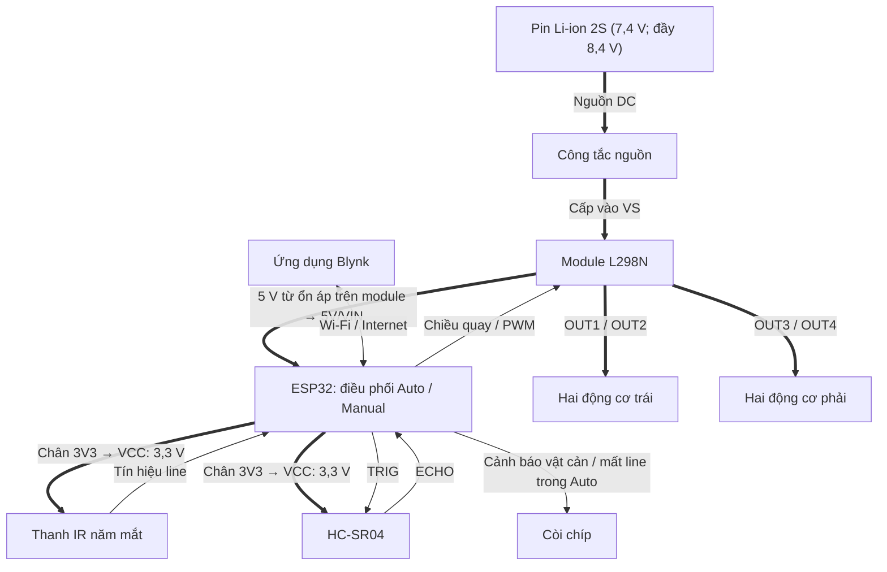

# Xe dò line kết hợp tránh vật cản và điều khiển từ xa qua Blynk

### Lộ trình thiết kế, chế tạo và phát triển trong 3 tuần

Thiết kế và chế tạo xe bốn bánh sử dụng ESP32 DevKit V1, cảm biến dò line năm mắt, HC-SR04, driver L298N và còi chíp cảnh báo. Hai chế độ **Auto–Manual** được lựa chọn qua ứng dụng Blynk trên điện thoại.

**Thời gian triển khai:** 3 tuần, từ lắp ráp và thử động cơ đến dò line, tránh vật cản và điều khiển qua Blynk.

README trình bày công việc theo từng tuần, các bước nâng cấp, đầu ra cần đạt và cách kiểm tra. Ngày được tính từ lúc bắt đầu dự án, kết quả thực tế được ghi sau khi thử xe.

**Phần cứng:** ESP32 · L298N · 4 động cơ DC · IR 5 mắt · HC-SR04 · Còi chíp (buzzer) · 2 cell pin Li-ion 18650 mắc nối tiếp — bộ pin 2S.

**Giao diện:** Blynk qua Wi-Fi/Internet.

## 1. Mục tiêu và hai chế độ vận hành

| Chế độ | Chức năng | Xử lý vật cản phía trước |
|---|---|---|
| **Auto  (chế độ 1)** | Bám vạch đen trên nền sáng, xử lý giao lộ và tìm lại line | Tạm dừng dò line, thực hiện chuỗi tránh đã lập trình, tìm lại vạch để tiếp tục |
| **Manual  (chế độ 2)** | Nhận lệnh Tiến, Lùi, Trái, Phải và mức PWM từ Blynk | Không kêu còi, không tự dừng hoặc chặn tiến do vật cản; người điều khiển quyết định chuyển động |

Còi chíp chỉ cảnh báo khi phát hiện vật cản hoặc mất line trong Auto. Ở Manual, còi không kêu khi gặp vật cản hoặc không thấy line.

Các mục tiêu kỹ thuật:

- Điều khiển độc lập **hai nhóm động cơ trái/phải**, mỗi nhóm hai động cơ cùng phía.
- Đọc năm mắt IR, tính sai lệch vị trí vạch và hiệu chỉnh bằng bộ điều khiển PID.
- Đo khoảng cách phía trước bằng HC-SR04 để phục vụ tránh vật cản và cảnh báo trong Auto, đồng thời hiển thị khoảng cách trên Blynk ở Manual.
- Trong Auto, phát âm cảnh báo bằng còi chíp khi phát hiện vật cản hoặc mất line.
- Giám sát trạng thái, khoảng cách và điều khiển hai chế độ qua Blynk.
- Đánh giá chức năng bằng phép thử có điều kiện, thông số và kết quả ghi nhận rõ ràng.

Một HC-SR04 cố định chỉ quan sát vùng phía trước, chưa giám sát phía sau và hai bên.

## 2. Lộ trình thực hiện và phát triển trong 3 tuần

| Giai đoạn | Trọng tâm | Đầu ra cần đạt |
|---|---|---|
| **Tuần 1 · Ngày 1–7** | Lắp ráp cơ khí, đấu nối nguồn và điều khiển động cơ | Xe chạy đúng các lệnh tiến, lùi, trái, phải, dừng và thay đổi được mức PWM |
| **Tuần 2 · Ngày 8–14** | Đọc IR, dò line cơ bản, nâng cấp PID và xử lý tình huống | Có phiên bản dò line để thử đường thẳng, cua, giao lộ và mất line |
| **Tuần 3 · Ngày 15–21** | Vận hành HC-SR04, còi chíp, Blynk, hai chế độ và kiểm thử tổng thể | Hoàn thiện chương trình và chạy  xe ở hai chế độ: tự động và điều khiển từ xa.  |

### 2.1. Tuần 1 — Lắp ráp và làm chủ chuyển động

**Mục tiêu:** Xây dựng nền tảng cơ khí, nguồn cấp và các lệnh chuyển động trước khi cho xe tự dò line.

| Thời gian | Công việc thực hiện | Cách kiểm tra |
|---|---|---|
| Ngày 1 | Xác định chức năng hai chế độ ,thống kê linh kiện, sơ đồ khối và bảng chân | Mỗi khối có chức năng, nguồn cấp và đường tín hiệu rõ ràng |
| Ngày 2–3 | Lắp khung, bốn động cơ, bánh xe, pin, ESP32 và L298N; đi dây nguồn | Khung chắc, bánh không cạ, dây không vướng bánh; kiểm tra cực tính và điện áp |
| Ngày 4–5 | Viết và thử riêng các lệnh tiến, lùi, trái, phải, dừng | Hai bánh cùng phía quay phối hợp đúng, gọi từng lệnh cho kết quả đúng hướng |
| Ngày 6 | Thêm PWM và thử nhiều mức điều khiển khi đặt xe xuống nền | Ghi mức PWM xe bắt đầu chuyển động, mức phù hợp để thử chậm và độ lệch hai bên |
| Ngày 7 | Kiểm tra lại chuyển động, nguồn và mối nối, lưu phiên bản điều khiển cơ bản | Xe thực hiện đủ các lệnh, dừng được và không khởi động lại trong điều kiện đã thử |

**Cách phát triển:** Thử một nhóm động cơ, sau đó thử cả hai nhóm; xác nhận chiều quay rồi mới thêm thay đổi PWM. Khi xe lệch hướng, kiểm tra cực tính, ma sát bánh và mức điều khiển hai bên trước khi chuyển sang thuật toán dò line.

**Đầu ra cuối tuần:**

- Khung xe và đường nguồn đã kiểm tra.
- Bảng chân ESP32–L298N và chương trình thử chuyển động.
- Ghi chép chiều quay, mức PWM đã thử và vấn đề cơ khí/nguồn còn tồn tại.

**Tiêu chí chuyển sang tuần 2:** Xe đáp ứng đúng từng lệnh chuyển động, có thể điều chỉnh PWM và dừng theo yêu cầu trong điều kiện thử nghiệm.

### 2.2. Tuần 2 — Từ dò line cơ bản đến PID

**Mục tiêu:** Đọc đúng năm mắt IR, cho xe bám vạch, sau đó cải thiện phản ứng ở cua, giao lộ và khi mất line.

| Thời gian | Công việc thực hiện | Cách kiểm tra |
|---|---|---|
| Ngày 8 | Gá thanh IR phía trước gầm, chỉnh độ cao/độ nhạy và in dữ liệu từng mắt | Đưa từng mắt lên nền trắng và vạch đen, xác nhận thứ tự trái qua phải và quy ước tín hiệu |
| Ngày 9 | Viết dò line theo điều kiện: vạch ở giữa, lệch trái, lệch phải và không thấy vạch | Xe hiệu chỉnh đúng hướng ở mức PWM thấp |
| Ngày 10–11 | Tính sai lệch từ năm mắt, thêm PID và hiệu chỉnh từng tham số | Thử cùng sa hình, ghi dao động, khả năng bắt cua và số lần mất line |
| Ngày 12 | Xác nhận giao lộ, chọn thứ tự ưu tiên rẽ và thử từng nhánh | Kiểm tra ngã ba/ngã rẽ: quan sát trường hợp nhận nhầm giao lộ |
| Ngày 13 | Bổ sung tìm lại line và thử quay đầu khi cần | Chủ động đặt xe lệch khỏi vạch: kiểm tra cả tìm thấy và tìm thất bại |
| Ngày 14 | Chạy lại các tình huống, ghi cấu hình và lưu bản dò line nền tảng | Mã nguồn, thông số và minh chứng thuộc cùng một phiên bản |

**Trình tự nâng cấp thuật toán:**

1. Đọc cảm biến và in dữ liệu để xác nhận từng mắt hoạt động đúng.
2. Điều khiển theo điều kiện: thấy vạch ở giữa thì tiến, vạch lệch bên nào thì hiệu chỉnh về bên đó.
3. Gán trọng số cho năm mắt, tính sai lệch và thêm PID để điều chỉnh hai nhóm động cơ.
4. Bổ sung xác nhận giao lộ và quy tắc chọn nhánh.
5. Bổ sung khôi phục line, quay đầu và xử lý khi tìm kiếm thất bại theo phiên bản chương trình.

Khi xe lao ra ngoài ở cua, dao động hoặc phản ứng chậm, kiểm tra theo thứ tự **vị trí cảm biến → logic đọc → chu kỳ xử lý → mức PWM → tham số PID**. Mỗi lần chỉ đổi một yếu tố và thử lại cùng điều kiện để xác định ảnh hưởng.

**Đầu ra cuối tuần:**

- Chương trình đọc IR, dò line theo điều kiện và dò line PID.
- Bảng thông số đã thử, kèm mức PWM và điều kiện sa hình.
- Minh chứng đường thẳng, cua, giao lộ và mất line.
- Danh sách vấn đề cần xử lý khi ghép HC-SR04/Blynk trong tuần 3.

**Tiêu chí chuyển sang tuần 3:** Đã kiểm tra phản ứng trên các tình huống cơ bản, lưu được phiên bản dò line để đối chiếu trước và sau tích hợp.

### 2.3. Tuần 3 — Tích hợp HC-SR04, Blynk và hai chế độ

**Mục tiêu:** Mở rộng xe dò line thành xe hai chế độ, xử lý tránh vật cản trong Auto, điều khiển còi cảnh báo tại ESP32 và kiểm thử toàn hệ thống.

| Thời gian | Công việc thực hiện | Cách kiểm tra |
|---|---|---|
| Ngày 15 | Kiểm tra HC-SR04 và còi chíp; thử đọc khoảng cách và bật/tắt còi riêng | So sánh với thước tại nhiều vị trí, ghi đơn vị, sai số và lần đo lỗi; kiểm tra còi đáp ứng lệnh bật/tắt |
| Ngày 16 | Ghép đo khoảng cách với dò line: xây dựng chuỗi tránh và tìm lại vạch | Thử vật cản trên sa hình ở mức PWM thấp: kiểm tra từng bước của chuỗi tránh |
| Ngày 17 | Thiết lập thiết bị, datastream và giao diện Blynk, thử nhận/gửi dữ liệu | Khoảng cách, trạng thái và lệnh nhận tại ESP32 khớp giao diện |
| Ngày 18 | Thêm Manual, bốn nút hướng và chỉnh PWM; không tự dừng/chặn tiến hoặc kêu còi do vật cản trong Manual | Kiểm tra nhấn/thả; trong Manual, gặp vật cản còi không kêu và lệnh Tiến không bị khóa; trong Auto, kiểm tra còi báo vật cản và mất line |
| Ngày 19 | Ghép chọn Auto–Manual, ưu tiên dừng và xử lý mất kết nối | Chỉ một chế độ điều khiển, đổi chế độ không phát lại lệnh hướng cũ |
| Ngày 20 | Chạy kiểm thử tổng thể, hiệu chỉnh và ghi kết quả | Thực hiện bảng kiểm ở mục 7, lưu điều kiện và minh chứng cho từng phép thử |
| Ngày 21 | Hoàn thiện báo cáo, hướng dẫn vận hành và đồng bộ kho mã nguồn | Tài liệu, chương trình nạp trên xe và minh chứng cùng phiên bản, ghi rõ nội dung chưa đạt |

**Các bước tích hợp chính:**

1. **Đo khoảng cách độc lập:** Kiểm tra HC-SR04 trước khi đưa kết quả đo vào điều khiển chuyển động.
2. **Auto:** Kết hợp dò line với phát hiện vật cản, dừng, thực hiện chuỗi tránh và tìm lại vạch; còi báo khi gặp vật cản hoặc mất line.
3. **Manual:** Nhận lệnh Blynk; gặp vật cản không kêu còi, không tự dừng hoặc chặn tiến do vật cản. Khoảng cách vẫn được hiển thị trên Blynk; người điều khiển quyết định hướng chạy và thời điểm dừng.
4. **Điều phối:** Dừng trước khi đổi chế độ, xóa lệnh cũ và ưu tiên yêu cầu dừng.
5. **Kiểm chứng:** Thử mất kết nối, dữ liệu khoảng cách lỗi và tình huống không tìm lại được line, điều chỉnh chương trình theo kết quả.

**Đầu ra cuối tuần:**

- Chương trình tích hợp đúng phiên bản và bảng cấu hình Blynk.
- Kết quả thử Auto–Manual và còi cảnh báo, kèm thông số, ảnh/video và các vấn đề chưa xử lý.

**Tiêu chí hoàn thành:** Các chức năng được kiểm chứng bằng phép thử có kết quả ghi nhận.hững mục chưa đạt tiếp tục nằm trong danh sách hoàn thiện. Chưa dùng việc có giao diện hoặc đã đấu nối cảm biến làm bằng chứng chức năng tích hợp hoạt động ổn định.

Công cụ sử dụng trong quá trình phát triển gồm MicroPython/Thonny, Arduino IDE cho các bản C/C++, Serial Monitor và GitHub. Các phiên bản chạy được cần được lưu trước mỗi lần nâng cấp để có thể đối chiếu hoặc khôi phục.

## 3. Kiến trúc hệ thống

Hình 3.1: Sơ đồ tổng quan hệ thống.

**Quy ước:** Mũi tên nét đậm thể hiện đường cấp nguồn và nguồn ra động cơ; mũi tên nét mảnh thể hiện đường tín hiệu điều khiển hoặc dữ liệu.

Theo đấu nối thực tế của mô hình, thanh IR năm mắt và HC-SR04 đều nhận nguồn **3,3 V từ chân 3V3 của ESP32**. GND của pin, L298N, ESP32 và các cảm biến được nối chung.

ESP32 đọc cảm biến và tiếp nhận dữ liệu Blynk vào các biến lệnh. Khối điều phối xét chế độ và điều kiện bảo vệ trước khi xuất lệnh cuối cùng cho L298N. Khoảng cách và trạng thái xử lý được gửi về ứng dụng để giám sát.

Các nút Blynk là thành phần phần mềm trao đổi qua datastream, chúng không sử dụng thêm GPIO như nút nhấn vật lý. Trong Auto, xử lý dừng, tránh vật cản và còi cảnh báo nằm tại ESP32. Trong Manual, vật cản không kích hoạt còi, không tự dừng hoặc chặn tiến; lệnh dừng qua Blynk phụ thuộc kết nối mạng.

## 4. Phần cứng và nguồn cấp

### 4.1. Linh kiện của mô hình

| Thành phần | Số lượng | Vai trò |
|---|---|---|
| ESP32 DevKit V1 | 1 | Đọc cảm biến, điều phối hai chế độ, tạo PWM và kết nối Wi-Fi |
| Module L298N cầu H đôi | 1 | Điều khiển chiều quay và PWM hai nhóm động cơ |
| Động cơ DC giảm tốc và bánh xe | 4 bộ | Tạo chuyển động cho bốn bánh chủ động |
| Thanh IR năm mắt | 1 | Xác định vị trí vạch đen trên nền sáng |
| HC-SR04 | 1 | Đo khoảng cách vật cản phía trước |
| Còi chíp (buzzer) | 1 | Cảnh báo vật cản và mất line trong Auto; tắt trong Manual |
| Khung xe mica | 1 bộ | Mang động cơ, cảm biến, pin và mạch điều khiển |
| Cell Li-ion 18650 mắc nối tiếp 2S | 2 | Nguồn danh định 7,4 V (8,4 V khi sạc đầy) |
| Công tắc và dây dẫn | Theo lắp ráp | Đóng/ngắt nguồn và kết nối các khối |

Hai động cơ cùng phía mắc song song trên một cầu H. Dòng qua mỗi cầu bằng tổng dòng hai động cơ, cần xét cả lúc khởi động/kẹt trục và khả năng tản nhiệt của driver.

### 4.2. Phân phối nguồn

| Nhánh nguồn | Kết nối và điều kiện |
|---|---|
| Pin 2S → công tắc nguồn → L298N | Cấp nguồn động lực vào VS của driver |
| Nhánh ổn áp 5 V trên module L298N → ESP32 | Cấp vào chân 5V/VIN theo đúng ký hiệu bo |
| 3V3 ESP32 → thanh IR | Chân VCC của thanh IR nối vào 3V3 ESP32, nhận nguồn 3,3 V |
| 3V3 ESP32 → HC-SR04 | Chân VCC của HC-SR04 nối vào 3V3 ESP32, nhận nguồn 3,3 V theo đấu nối thực tế |
| GND | Nối chung mass của pin, ESP32, L298N và cảm biến |

### 4.3. Bố trí cơ khí

- Thanh IR đặt phía trước gầm xe, hướng xuống mặt đường: cân chỉnh độ cao/độ nhạy theo sa hình.
- HC-SR04 hướng về trước, không bị khung hoặc dây dẫn che hai đầu dò.
- Cố định pin, dây và các mối nối để hạn chế rung, va quệt và đứt dây.

## 5. Cấu hình chân ESP32

### 5.1. Driver L298N

| ESP32 | L298N | Chức năng |
|---|---|---|
| GPIO27 | IN1 | Chiều quay nhóm trái |
| GPIO26 | IN2 | Chiều quay nhóm trái |
| GPIO14 | ENA | PWM nhóm trái |
| GPIO25 | IN3 | Chiều quay nhóm phải |
| GPIO33 | IN4 | Chiều quay nhóm phải |
| GPIO32 | ENB | PWM nhóm phải |
| GND | GND | Mass chung |

OUT1/OUT2 nối nhóm trái, OUT3/OUT4 nối nhóm phải; kiểm tra cực tính để hai bánh cùng phía cùng đẩy xe theo hướng yêu cầu. Tháo jumper ENA/ENB khi dùng PWM từ ESP32. Hai jumper này khác jumper nguồn 5V-EN.

### 5.2. Thanh IR năm mắt

VCC của thanh IR nối chân 3V3 của ESP32 để nhận nguồn 3,3 V; GND nối mass chung.

Thứ tự từ trái sang phải khi nhìn theo hướng xe tiến:

| Mắt cảm biến | ESP32 GPIO | Trọng số |
|---|---|---|
| SS1 — ngoài trái | 18 | −2 |
| SS2 — trái | 19 | −1 |
| SS3 — giữa | 21 | 0 |
| SS4 — phải | 22 | +1 |
| SS5 — ngoài phải | 23 | +2 |

Quy ước trong chương trình nền tảng:

- **GPIO thô:** đen = LOW/0, trắng = HIGH/1.
- **Mảng chuẩn hóa của `read_line()`:** 1 nghĩa là mắt đang nhận vạch đen, 0 là không nhận vạch.

Ví dụ vạch ở mắt giữa có thể cho GPIO thô `11011` và mảng chuẩn hóa `00100`. Hai cách biểu diễn khác nhau, cần đọc thử từng mắt trên đen/trắng trước khi chạy xe.

### 5.3. HC-SR04

| Chân | Kết nối |
|---|---|
| TRIG | GPIO4 |
| ECHO | GPIO13 |
| VCC | Chân 3V3 của ESP32, nguồn 3,3 V theo đấu nối thực tế |
| GND | GND chung |

ESP32 phát TRIG và đo **độ rộng xung ECHO** để xác định khoảng cách theo thời gian truyền âm khứ hồi. TRIG và ECHO là hai đường tín hiệu riêng.

### 5.4. Còi chíp (buzzer)

Còi được điều khiển từ ESP32. GPIO điều khiển và cách cấp nguồn cần được ghi theo loại còi, mạch điều khiển và đấu nối thực tế; file hiện chưa cung cấp các thông tin này.

| Chế độ | Điều kiện bật còi | Điều kiện tắt còi |
|---|---|---|
| Auto | Phát hiện vật cản trong ngưỡng cảnh báo hoặc mất line | Không còn vật cản trong ngưỡng cảnh báo và đã nhận lại line |
| Manual | Không kích hoạt còi | Còi luôn tắt trong Manual |

Khi chuyển từ Auto sang Manual, tắt còi nếu đang kêu. Ở Manual, vật cản không kích hoạt còi và không khóa các lệnh Tiến, Lùi, Trái, Phải. Các yêu cầu dừng bằng nút Blynk, thả nút hướng, đổi chế độ và mất kết nối vẫn được xử lý như trước.

## 6. Thiết lập Blynk trong tuần 3

**Bảng chức năng các thành phần giao diện Blynk**
| Thành phần | Chiều dữ liệu | Chức năng |
|---|---|---|
| Trạng thái | ESP32 → Blynk | Hiển thị trạng thái xử lý như tiến, lùi, rẽ, dừng hoặc vật cản |
| Đồng hồ khoảng cách | ESP32 → Blynk | Hiển thị HC-SR04: giao diện hiển thị  miền từ 0 đến 200 cm khoảng cách so với vật cản |
| Manual / Auto | Blynk → ESP32 | Lựa chọn chế độ vận hành |
| Tiến | Blynk → ESP32 | Yêu cầu tiến trong Manual; gặp vật cản không bị chặn tiến và không kêu còi |
| Lùi | Blynk → ESP32 | Yêu cầu lùi trong Manual,  |
| Trái | Blynk → ESP32 | Yêu cầu rẽ/quay trái trong Manual |
| Phải | Blynk → ESP32 | Yêu cầu rẽ/quay phải trong Manual |
| Dừng khẩn cấp | Blynk → ESP32 | Gửi yêu cầu dừng hai nhóm động cơ ở cả hai chế độ |
| Tốc độ | Blynk → ESP32 | Điều chỉnh tốc độ của xe cả ở 2 chế  |
| PID | Blynk → ESP32 | Gửi một giá trị hiệu chỉnh theo biến và thang quy đổi của firmware |

### Yêu cầu xử lý lệnh 

- Chỉ một chế độ quyết định chuyển động: nút hướng Manual không ghi đè Auto.
- Dừng trước khi đổi chế độ, xóa lệnh hướng cũ và đặt lại PID khi vào Auto.
- Nút hướng dùng kiểu **Push**: nhấn để gửi lệnh, thả để kết thúc lệnh.
- Dừng khẩn cấp được ưu tiên, hủy dừng cần lệnh chạy mới, không tự phát lại lệnh cũ.
- Ở Manual, mất kết nối hoặc hết thời hạn hiệu lực của lệnh phải dừng, kết nối lại chờ lệnh mới.
- Trong Auto, xử lý dữ liệu khoảng cách lỗi/quá cũ trước quyết định chuyển động. Trong Manual, khoảng cách chỉ phục vụ giám sát, không kích hoạt còi và không dùng để tự dừng hoặc chặn tiến.
- Xử lý lệnh hướng mâu thuẫn trước lệnh chạy.

Các yêu cầu này cần được kiểm chứng với firmware tích hợp. Nút Dừng khẩn cấp Blynk gửi lệnh qua mạng, công tắc nguồn tại xe đóng/ngắt nguồn vật lý.

## 7. Kiểm chứng chức năng

Kế hoạch theo báo cáo gồm 13 nhóm chức năng. Ghi điều kiện, thông số đặt, kết quả thực tế và ảnh/log/video cho từng phép thử.

| Phép thử | Điều cần xác nhận |
|---|---|
| 1. Đo khoảng cách HC-SR04 | So sánh với thước tại nhiều vị trí, ghi sai số và đơn vị |
| 2. Dò line | Bám đường thẳng/cua, quan sát lệch và dao động |
| 3. Phát hiện vật cản | Auto: còi báo, dừng để thực hiện chuỗi tránh; Manual: không kêu còi, không tự dừng hoặc chặn tiến do vật cản |
| 4. Tránh và tìm lại line | Hoàn thành chuỗi tránh, nhận lại vạch rồi tiếp tục dò |
| 5. Dữ liệu khoảng cách lỗi | Auto: xử lý timeout/giá trị không hợp lệ, không coi lỗi là đường trống; Manual: không dùng dữ liệu khoảng cách để tự khóa chuyển động |
| 6. Giám sát Blynk | Hiển thị khớp dữ liệu ESP32 gửi, ghi chu kỳ cập nhật |
| 7. Manual và bốn nút hướng | Đúng hướng, đúng phản ứng nhấn/thả và giới hạn PWM |
| 8. Chuyển Manual/Auto | Dừng khi chuyển, xóa lệnh cũ, đúng chế độ quyết định chuyển động |
| 9. Thanh Tốc độ | Giá trị nhận và PWM áp dụng đúng phép quy đổi |
| 10. Thanh PID | Đúng biến/hệ số và miền giá trị |
| 11. Dừng khẩn cấp Blynk | Có tác dụng hai chế độ, hủy dừng không tự chạy lại |
| 12. Mất kết nối và kết nối lại | Dừng theo cơ chế phát hiện/hết hạn lệnh, khôi phục kết nối chờ lệnh mới |
| 13. Còi cảnh báo | Auto: còi kêu khi có vật cản hoặc mất line, tắt khi hết điều kiện cảnh báo; Manual: còi không kêu khi có vật cản hoặc không thấy line; chuyển từ Auto sang Manual phải tắt còi đang kêu |

## 8. Giới hạn và hướng hoàn thiện

| Giới hạn hiện tại | Hướng hoàn thiện |
|---|---|
| Một HC-SR04 hướng trước | Cân nhắc thêm cảm biến bên/phía sau, cơ cấu quét |
| Chuỗi tránh chịu ảnh hưởng trượt bánh và mặt đường | Hiệu chỉnh theo sa hình, thêm encoder/IMU khi cần đo chuyển động |
| Dừng Blynk phụ thuộc mạng | Kiểm chứng bảo vệ cục bộ, hết hạn lệnh và hành vi kết nối lại |

## 9. Đầu ra của lộ trình và hướng tiếp tục

Sau 3 tuần, bộ hồ sơ dự án cần gồm cấu hình phần cứng, sơ đồ đấu nối, các phiên bản chương trình, cấu hình Blynk, hướng dẫn vận hành và kết quả thử nghiệm. Mục tiêu là phát triển từng bước từ xe điều khiển động cơ cơ bản đến xe dò line có tránh vật cản và điều khiển từ xa.
Công việc tiếp tục theo chu trình **Thiết kế → Triển khai → Thử nghiệm → Đánh giá → Cải tiến** (*Design → Implement → Test → Evaluate → Improve*). Các hướng phát triển sau 3 tuần được trình bày tại mục 8.

## Tài liệu kỹ thuật tham khảo

- [L298 — STMicroelectronics](https://www.st.com/en/motor-drivers/l298.html).
- [Module L298N có ổn áp 5 V — Handson Technology](https://www.handsontec.com/dataspecs/module/L298N%20Motor%20Driver.pdf).
- [HC-SR04 bản 5 V — SparkFun](https://www.sparkfun.com/ultrasonic-distance-sensor-hc-sr04.html).
- [HC-SR04 biến thể 3,3–5 V — SparkFun](https://www.sparkfun.com/ultrasonic-distance-sensor-3-3v-hc-sr04.html).
- [Blynk Datastreams](https://docs.blynk.io/en/getting-started/template-quick-setup/set-up-datastreams).
- [Blynk Button](https://docs.blynk.io/en/blynk.apps/widgets-controllers/button), [Slider](https://docs.blynk.io/en/blynk.apps/widgets-controllers/slider) và [Gauge](https://docs.blynk.io/en/blynk.apps/widgets-displays/gauge).
